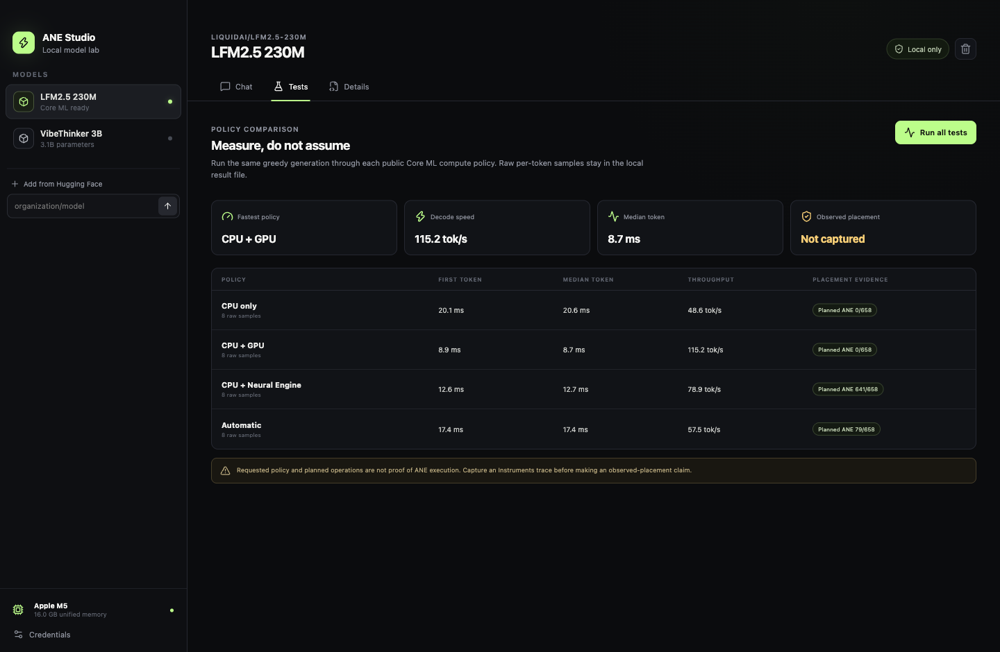

# ANE Studio

A local macOS app that converts small Hugging Face language models to Core ML, checks source-to-Core-ML parity, and compares Apple Silicon compute policies. Chat runs on your Mac, not a hosted inference API.



## Install

Use an Apple Silicon Mac with macOS 15 or newer. We test on a Mac with 16 GB unified memory. Leave at least 8 GB free for the app, one small model, and conversion scratch files. Larger checkpoints need more space and memory.

Public builds appear on the [GitHub releases page](https://github.com/Mr-Neutr0n/ane-studio/releases). If no release is listed, use the source setup below.

A release ZIP includes Python and the locked worker dependencies. You do not need Bun, uv, Homebrew, or a system Python to run it. It does not include model weights. The first model download needs an internet connection.

### Unsigned preview builds

These builds have no Apple Developer ID signature and are not notarized. Some bundled native files have local ad-hoc signatures so macOS can execute them. Those signatures do not identify a trusted publisher.

1. Download the versioned Apple Silicon ZIP and `SHA256SUMS` from the same release.
2. In that download directory, run `shasum -a 256 -c SHA256SUMS` in Terminal.
3. Extract the ZIP and move `ANE Studio.app` to Applications.
4. Open it. If macOS blocks it, review the publisher and checksum before using System Settings > Privacy & Security > Open Anyway. Apple documents this [per-app exception](https://support.apple.com/en-us/102445).

Do not disable Gatekeeper globally. If your Mac's policy does not allow unsigned apps, use the source setup or wait for a Developer ID signed release. We have not verified a downloaded, quarantined build on a second clean Mac.

### Run from source

Install [Bun](https://bun.sh/) and [uv](https://docs.astral.sh/uv/) through their official instructions, then run:

```bash
git clone https://github.com/Mr-Neutr0n/ane-studio.git
cd ane-studio
bun install --frozen-lockfile
bun run worker:setup
bun run dev
```

Release builds use Bun `1.3.13`, uv `0.11.17`, and managed CPython `3.12.13`. You do not need Xcode for source setup. Release packaging uses Apple's command-line tools. Full Xcode is needed only for Instruments profiling and observed-placement evidence.

If source startup cannot find uv, start from this Terminal or set `ANE_STUDIO_UV` to its absolute executable path. Packaged builds never run uv.

## First model

Select `LFM2.5 230M`, choose **Convert to Core ML**, and wait for download, conversion, and parity. Public models do not need a Hugging Face token. Gated or private models still require access from their publisher.

The app will not enable chat or benchmarks unless logit cosine similarity is at least `0.999` and the source and Core ML top token match. A compatible architecture alone does not prove that a checkpoint works.

See [model support](docs/model-support.md) for exact checkpoint revisions, adapters, admission rules, failures, and networked smoke commands. [Compatibility results](docs/compatibility-results.md) record the development measurements. Model licenses are separate from the app's MIT license.

## What the app does

- Inspects Hugging Face metadata before downloading model weights.
- Pins downloaded snapshots to exact revisions.
- Converts fixed-shape models and checks parity before use.
- Streams local chat through Core ML.
- Compares CPU, CPU+GPU, CPU+ANE, and automatic compute policies.
- Retains raw token latency samples and planned operation counts.
- Stores Hugging Face credentials with Electron `safeStorage` and macOS Keychain.

Chat and benchmarks run locally after preparation. Metadata lookup and model downloads contact Hugging Face. The app disables Hugging Face telemetry and does not send prompts to a hosted model.

## Placement is evidence, not a switch

A CPU+ANE policy is not "ANE-only." Core ML can partition the graph or fall back. The app separates:

- Requested placement, the devices a compute policy permits.
- Planned placement, the device assignments in `MLComputePlan`.
- Observed placement, accelerator activity in an Instruments trace aligned with inference.

The app automates requested and planned evidence. A developer profiling tool captures
observed activity separately. [October 2026 execution checks](docs/ane-observations.md)
confirmed ANE activity for the tested LFM2.5 packages. Keep profiling separate from
timing because Instruments changes latency.

### Measured M5 smoke result

`LiquidAI/LFM2.5-230M` at revision `40cb2ad3b3044d5a41eee083a6103c8b523afa45` passed conversion at a fixed 64-token shape on an Apple M5 MacBook Air with 16 GB unified memory.

- Core ML artifact, 459.8 MB.
- Logit cosine similarity, `0.999936`, with matching top token.
- Chat for "Say hello in one short sentence" returned `Hello! How can I assist you today?`
- Planned CPU+ANE placement, 641 of 658 non-constant operations on ANE.
- Observed placement, not captured.

One interactive policy run produced:

| Policy | Median token | Throughput | Planned placement |
| --- | ---: | ---: | --- |
| CPU only | 20.6 ms | 48.6 tok/s | 658 CPU operations |
| CPU + GPU | 8.7 ms | 115.2 tok/s | 658 GPU operations |
| CPU + ANE | 12.7 ms | 78.9 tok/s | 641 ANE, 17 CPU operations |
| Automatic | 17.4 ms | 57.5 tok/s | 79 ANE, 574 GPU, 5 CPU operations |

These are development smoke numbers, not a universal hardware ranking. The runtime recomputes the fixed context each token without a stateful KV cache. Policy tests run sequentially in one worker process.

## Data and privacy

Local data remains under:

```text
~/Library/Application Support/ANE Studio/
```

Removing a model in the app deletes its snapshot, converted package, manifest, and benchmark reports. This directory and app ID `dev.harikrishna.anestudio` stay stable across updates. `ANE_STUDIO_HOME` can select an isolated directory for tests.

The sandboxed renderer has no Node.js access. It uses a typed preload bridge. The main process validates requests and supervises the local Python worker. The worker loads models without Hugging Face remote custom code.

Read [architecture](docs/architecture.md), [privacy](docs/privacy.md), and [security](SECURITY.md) for the process and storage boundaries.

## Verify

The full check includes the public website and browser tests:

```bash
bun install --frozen-lockfile
bun install --cwd website --frozen-lockfile
cd website
bunx playwright install chromium webkit
cd ..
bun run verify
```

It runs TypeScript and formatting checks, renderer and main-process tests, Python worker tests, production builds, Electron startup tests, website checks, and a repository credential scan. It does not download model weights. Model conversion changes also need the networked commands in [model support](docs/model-support.md).

## Build a self-contained app

On Apple Silicon with Apple's command-line tools installed:

```bash
bun run release:local
```

This builds a separate locked environment in ignored `artifacts/`, bundles CPython and the worker dependencies, collects license notices, relocates native library references, and checks native dependencies. It then builds the app, runs a clean-data launch with uv absent from PATH, and writes:

```text
dist/mac-arm64/ANE Studio.app
dist/ANE-Studio-0.1.0-arm64.zip
dist/SHA256SUMS
```

`bun run package` builds just the app. `bun run package:test` repeats the packaged runtime and Electron startup checks. The packaged check imports Torch, Transformers, and Core ML Tools without using a developer Python environment.

A version tag matching `package.json` starts the [release workflow](.github/workflows/release.yml). It runs verification and creates a draft GitHub release. A maintainer must review model evidence and publish the draft. CI does not perform networked model conversion or prove observed accelerator activity.

## Limits

- Default conversion uses a fixed 64-token context. This is a small-model conversion lab, not a long-context chat replacement.
- Architecture support and checkpoint validation are separate. See the current model support list before downloading large weights.
- CPU+ANE compilation can be slow. A planned ANE assignment does not prove measured ANE activity.
- The app is Apple Silicon only. Intel Macs, Windows, and Linux cannot run its Core ML worker.
- Developer ID signing and notarization are not configured.
- Model licenses can restrict commercial use even though the app is MIT licensed.

## License and contributions

Source code is MIT licensed. Downloaded models keep their original licenses. See [LICENSE](LICENSE), [MODEL_LICENSES.md](MODEL_LICENSES.md), [third-party notices](THIRD_PARTY_NOTICES.md), and [contributing](CONTRIBUTING.md).
